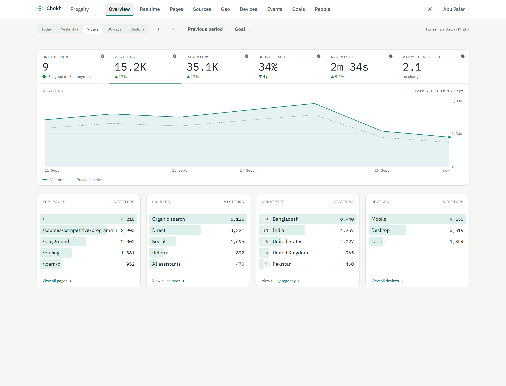
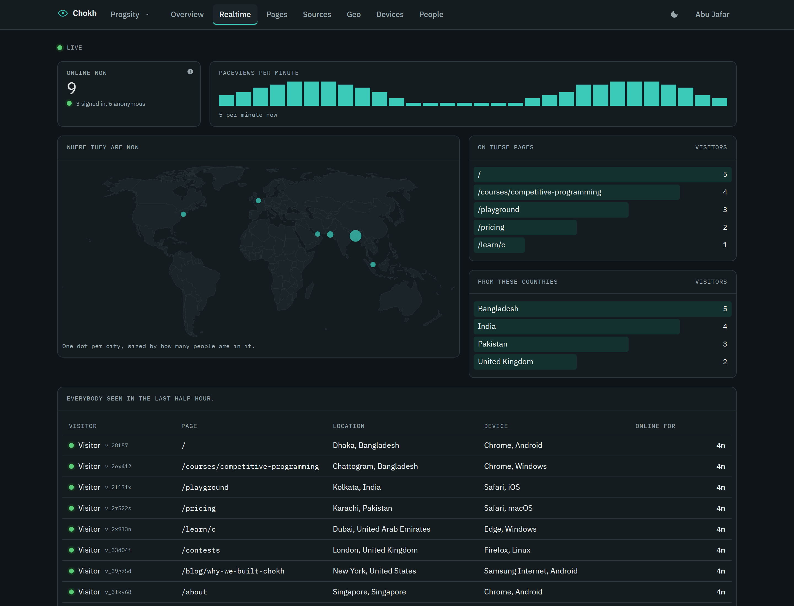
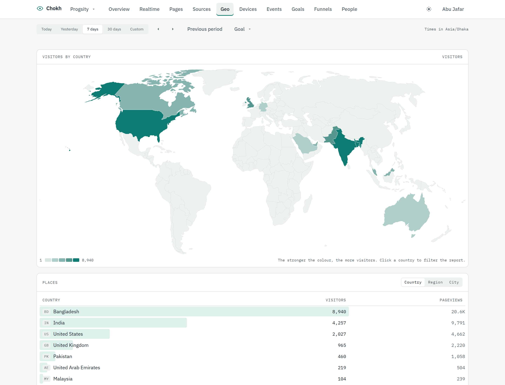
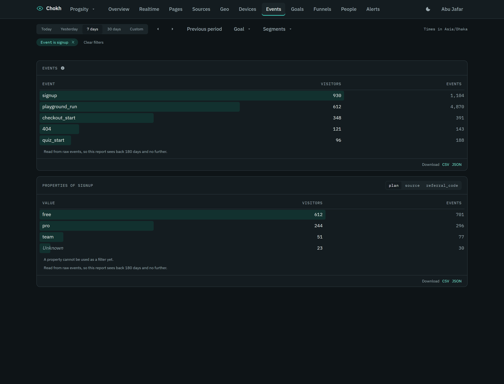
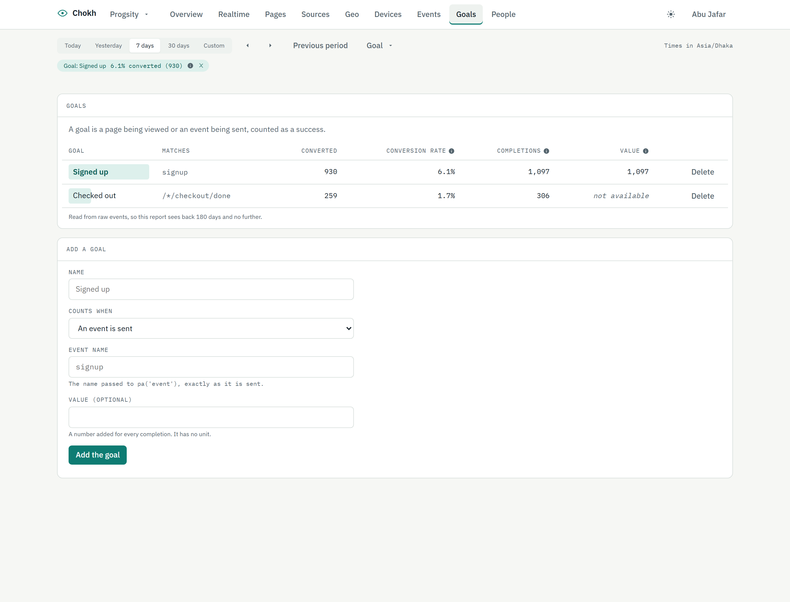
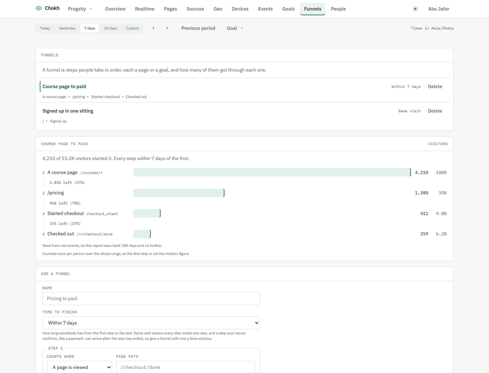
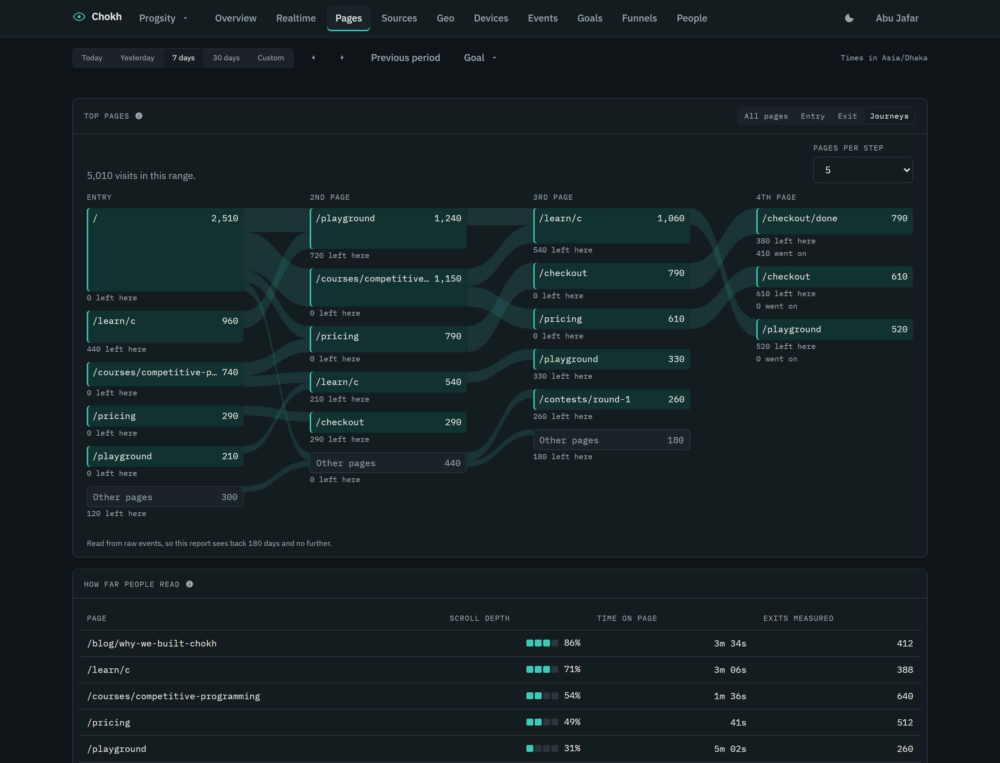
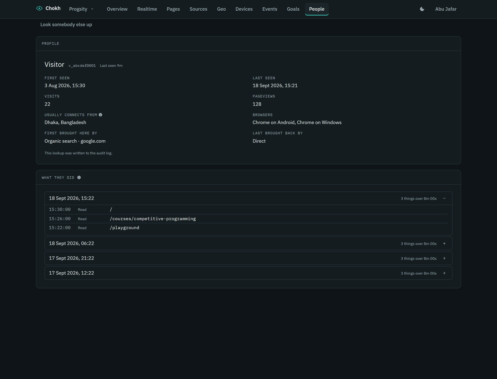

# Chokh

**Status: pre-release.** Nothing here is stable yet. The engine is being built
ticket by ticket; see [AGENTS.md](AGENTS.md) for how the work is run.

Chokh (চোখ, "eye") is open source, first-party web analytics you host
yourself. One process carries the whole product: a tracker script under 3 KB,
a collector, a stats API, a realtime stream and a dashboard.

## What it gives you

- Visitors, visits, pageviews, bounce and visit duration, with compare
- Pages, entry and exit pages, time on page and scroll depth
- Referrers, channels (including AI assistants) and UTM campaigns
- Country, region and city from an offline IP database, plus browser, OS and device
- Who is on the site right now, which page they are on and how long they have been there
- Custom events, `identify` for signed-in people, per-person history, and a
  directory of everybody with search and an identified-only switch
- Goals with a conversion column on every report, funnels with the drop-off at
  every step, and the paths visits took from the page they came in on
- Segments: any filter list saved under a name, applied in one press and drawn
  against the chart as a second line; route groups that fold `/courses/:slug`
  into one row; and the site's own traffic kept out by address, path or query
  parameter
- Annotations: a deploy, a campaign, an outage or a note drawn as a mark on the
  chart, posted from the dashboard or by a deploy pipeline with the key it
  already holds
- Privacy as configuration: cookieless or persistent visitor ids, full, anonymised or
  no IP storage, bot filtering, per-site retention
- A JSON API for all of it, with a CSV export and a live stream of who is here
- Accounts, teams and API keys, and a scope of its own for reading addresses and
  identified people, with an audit row for every such read
- Single sign-on, so a staff member clicks through from your own admin panel and
  is already signed in

## The dashboard



Six numbers, one chart, four cards, and nothing else on the first screen. Every
number carries a comparison, because a number on its own is not something
anybody can act on. Clicking any row filters the whole page rather than opening
another one: click a country and the pages, the sources and the devices become
that country's.

The five rules it is designed around:

1. The first screen answers the question. Everything else is a report somebody
   asked for.
2. Every number carries a comparison.
3. One accent colour. Green and red mean good and bad, never "this series" and
   "that series".
4. Any row can be clicked to filter, and a row that cannot be filtered is not
   dressed up as one that can.
5. Nothing pretends. A read that failed says so instead of drawing a zero, a
   number nobody measured says "not available" instead of 0, and a page nobody
   has closed yet has no time on page rather than a time of nought.

**Realtime** is the report that says who, and not only how many.



Online first, then everybody seen in the last half hour in a muted tone,
because a page that empties at three in the morning reads as broken. The map
places a dot per city from coordinates that were rounded to two decimals, about
a kilometre, when the presence entry was written: what is kept is where a city
is, and it was never anything finer. An address is a different matter and
appears only for an account with `read:identity`, which is said on screen along
with the fact that the read was logged.

**Geography** paints five bands on a log scale.



A continuous ramp looks more precise and reads worse: nobody can tell 1,400
from 1,700 by shade, and on analytics data a linear scale paints the world in
the lightest band with one country in the darkest. The outlines are projected
once at build time and shipped as path strings, so no browser downloads a
mapping library to draw a file that never changes.

**Events** lists what your pages and your server said happened, by name.



A page timing is not an event and is not in the list. Clicking an event filters
the page to it, the same as any other row, and the card under it breaks that
event down by the properties it carried: one tab per property, most used first,
and an Unknown row for the times it was sent without one, so the rows add up to
the event.

**Goals** turn a page or an event into a success, and every report can then be
read against one.



A goal is a page being viewed (a `*` stands for one part of the path, so
`/*/checkout/done` covers every locale prefix) or an event being sent, with an
optional value that is a plain number with no unit. Choose one in the range bar
and every breakdown gains a conversion column: the share of each row's visitors
who reached the goal that same day, counted a day at a time like visitors, so it
never passes 100%. The goal is carried in the link, so "of the people from this
campaign, how many signed up" is a view somebody can send. A goal is a question
asked of the raw events rather than a counter, so one added today answers for
every day the events still cover, and deleting one loses nothing. Only an owner
of the site adds or removes goals.

**Funnels** are steps people take in order, each a page or one of your goals,
and how many of them got through each one.



A funnel has two to eight steps and a time to finish: the same visit, or an
hour, a day, 7 days or 30 days from the first step to the last. Seven days is
the default on a site that remembers its visitors, and the same visit on a
cookieless one, whose visitor ids cannot follow anybody across midnight. Each
step is a bar as long as its share of the first, with the count and the share
beside it as text, and between two steps it says how many left, in grey rather
than red: a funnel narrows by design, and leaving one is not an error. A person
counts once over the whole range, so over several days the first step is not the
Visitors figure, and the page says so under the drawing. The funnel being read
is carried in the link, the filters narrow the people and never the steps, and a
step made from a goal copies the goal's question, so deleting the goal changes no
funnel. Like a goal, a funnel is a question asked of the raw events: deleting
one loses nothing, and only an owner of the site adds or removes one.

**Retention** asks who comes back. Cohorts group people by the week or month
they were first seen and shade the share of each that returned in every later
one, the bucket still running drawn open rather than read as a drop. Activity
draws daily, weekly and monthly active people, stickiness (an ordinary day's
share of the month's people), the returning rate, how many days people came (the
power user curve) and the most active people, named only for an account allowed
to see names. Attribution splits everybody who reached a goal by what first
brought them and by the visit they converted in, across days. It reads visits,
so on a site with cookieless ids, whose visitor ids last a day, it says why
nobody is seen to return.

**Journeys** is the fourth tab of Top pages, beside Entry and Exit: the paths
visits took from the page they came in on through the next three.



It counts visits, not visitors, because a path is a fact about one visit, and a
page reloaded back to back is one step. Each step keeps its most visited pages,
3, 5 or 10 of them, chosen in the card and kept in the link, and folds the rest
into Other; every node says how many visits ended there, so every column adds
up. Pressing a page narrows the report to the visits that saw it. On a phone the
flow keeps a width a path can be read at and scrolls inside its card, and the
same numbers are there as a table for a screen reader.

**It comes with the server.** There is no second process, no separate host and
no CDN: `docker compose up` serves the dashboard and the collector on one
origin, which is also why the session cookie works and why nothing here is a
cross-origin request.

### What it costs to load

One run of `pnpm size:dashboard` on 2026-09-25, which walks `dist/` and gzips
every file that gzip does anything to. Bytes, because a kilobyte means two
things and half a table in each is how a figure stops being checkable:

| | bytes, gzipped |
| --- | --- |
| The first paint: the shell, the Overview and what they share | 39,478 |
| Libraries: React, the router, the query cache | 84,611 |
| The world map, loaded by Realtime and Geo and by nothing else | 39,923 |
| The ten other reports, the Journeys tab, the annotations panel and the shared page, one file each, loaded when opened | 39,649 |
| Stylesheets | 16,125 |
| Fonts: IBM Plex Sans and Mono, latin, woff2 | 60,420 |

The fonts are counted because they are served from the install: a dashboard
that fetches a font from somebody else's CDN tells that CDN who is reading it,
which is the thing this product exists not to do. The budgets are per group,
and CI fails a build that puts any group over its own.

### Accessibility

Lighthouse scores it 1 on the Overview, on Realtime, on Funnels with a funnel
drawn, on the Journeys tab, on People, on Retention's cohort grid and its
activity view, on the settings page, on the Alerts page as an
install with no key sees it, and on the shared page as somebody with the link
and no session sees it, in both the light and the dark palette, against the
real server rather than a fixture. CI fails under 1, and the run also asserts
that the page it audited had the dashboard rendered in it, because Lighthouse
scores a blank page 1. Every chart carries its numbers as a table for a screen
reader, including the world map.

### Segments, routes and exclusions

Every row on every report is a filter, the entry page, the exit page and the
channel included: the store answers those by the visits that match. A filter
list worth keeping is saved as a segment from the Segments menu in the range
bar, applied again in one press, and compared against: the chart draws the
segment's own numbers as a second line under its name while the previous
period steps aside. Saving and deleting a segment is an owner's, like a goal.

A site with dynamic pages folds them with a route rule in its settings:
`/courses/:slug` reads every course as one row on the Routes tab of Pages, in
order, first match wins, `:name` for one part of the path and `*` for any run
inside one. A rule change regroups the stored history within retention on the
next hourly pass, and the page says so until it has.

The same settings page, reached from the site menu, keeps the site's own
traffic out by address or range, by path and by query parameter, applied as a
batch arrives; and it holds the name, the domains, the retention and the
privacy modes. The timezone is shown there and is not a control, because a
year of daily numbers is keyed by it.

### Annotations and alerts

A deploy, a campaign, an outage or a note is a mark on the chart: a dotted
guide at the bucket it happened in, named in the hover and in a hidden list,
so a step in the line has its reason beside it. Marks are added from the panel
in the chart head by an owner or an editor, or posted by a deploy pipeline
with the key it already holds (`POST /api/sites/:siteId/annotations`); the id
is derived from the fact, so a retried post is one mark.

Alerts are part of Chokh Pro and the eleventh destination on every install: on
one with no key the page names the feature, says so in one sentence and
describes the four kinds and the three ways out in words, with nothing
pretending to be numbers. With a key, an alert is a question asked every five
minutes (traffic against the same weekday's hour, a goal count, an error
burst, silence) and a message to Telegram, to an address or to a signed
webhook once when it starts and once when it is back to normal. The page
lists each alert with what it watches, where it goes and what happened last,
and sends a test on every channel so a bot token is proved before the night
it matters. The rest is in [packages/ee](packages/ee/README.md#alerts).

### Exports, sharing and digests

Every report card has a Download control: CSV as the server writes it, with
the range and the filters on screen (`GET /api/sites/:siteId/export.csv?report=`
names the kind, one fixed column set each), and JSON as what the card holds,
both under one name. People and Realtime are not exported: one is identity,
the other a snapshot.

A site can have one public share: a link that shows the Overview's numbers,
chart, top pages, sources, countries and devices to anybody who has it, and
nothing about a person. The owner makes it on the settings page, puts a
password on it or takes one off, replaces the link (which ends the old one)
or turns it off. Search engines are told to stay away. Two things to embed
come with it: a badge, one metric over a range as an image for a README, and
the five tiles alone in a page an iframe may hold, which is the one page of
the dashboard that may be framed. The rest is in
[packages/server](packages/server/README.md#the-public-share).

Digests are part of Chokh Pro, on the Alerts page: the same numbers mailed
every morning about yesterday, or once a week about the week before, as text,
as HTML and as one page attached, to up to five addresses, at an hour of the
site's own day. The rest is in [packages/ee](packages/ee/README.md#digests).

### Keyboard

`g` then a letter for a report, `t` `y` `7` `3` for the ranges, `[` and `]` to
step the window, `c` for the comparison, `x` to clear the filters, `l` for the
palette. `?` lists them all. Nothing fires while you are typing, and nothing
takes a key the browser already uses.

### Pictures and audits

```bash
pnpm build
pnpm --filter @chokh/dashboard run shots   # thirty-four screenshots, seventeen views in two themes
pnpm --filter @chokh/dashboard run a11y    # the audit above, as JSON
pnpm --filter @chokh/dashboard run test:e2e
```

The browser suite and the audit run against the real server on an in-memory
store, so neither needs a database or Redis and both see the envelope, the session
cookie and the stream a person gets. The screenshots run against a fixture with
a frozen clock instead, so the same command produces the same pictures.



## One-line install

```bash
git clone https://github.com/chokh-analytics/chokh.git && cd chokh && docker compose up
```

The dashboard and the collector are then on `http://localhost:4100`, with
PostgreSQL and Redis beside them and the tables already created. Nothing needs
setting first. Register the first account, which owns the install, and create a
site:

```bash
curl -c jar -X POST localhost:4100/api/auth/register \
  -H 'content-type: application/json' \
  -d '{"email":"you@example.com","password":"a-long-enough-password"}'

curl -b jar -X POST localhost:4100/api/sites \
  -H 'content-type: application/json' \
  -d '{"id":"my_site","name":"My site","domains":["example.com"],"settings":{"timezone":"Asia/Dhaka"}}'
```

The site's timezone goes inside `settings`, as `settings.timezone`; a
`timezone` at the top of the body is not read, and the site keeps the default.

Then drop the script into any page you want counted:

```html
<script defer data-site="my_site" src="https://analytics.example.com/a.js"></script>
```

The API, its scopes and its SSO exchange are documented in
[packages/server/README.md](packages/server/README.md).

## Which database

Chokh runs on PostgreSQL 15 or newer, or on MongoDB 5.0 or newer. Storage sits
behind one interface, both adapters pass the same conformance suite, and every
report means the same thing on either.

**PostgreSQL is the default.** `docker compose up` starts PostgreSQL 17 and
creates the tables before the server starts. It is the default for three
reasons: it is the database most people who host their own software already
run, back up and can rent from any provider; its licence asks nothing of
whoever hosts it, where MongoDB's server is under the SSPL; and `events` is
kept in one partition per month, so a month that retention has emptied gives
its disk back at once.

**MongoDB is the other supported path, and not a lesser one.** Its adapter is
the older of the two and the one that has run in production the longest. Start
it with its own file, then create the indexes once:

```bash
docker compose -f docker-compose.mongodb.yml up -d
```

```bash
docker compose -f docker-compose.mongodb.yml exec server node packages/store-mongo/dist/migrate.js --apply
```

Without compose, the server chooses by what it is given: `DATABASE_URL` for
PostgreSQL, `MONGODB_URI` for MongoDB. It refuses to start with both, and in
production with neither.
[packages/server/README.md](packages/server/README.md#storage) has the rest.

### Before anybody else can reach it

As they ship, both compose files are for one machine: every port is published
on `127.0.0.1` only, PostgreSQL is not published at all, and the session secret
and the database password are development values that anybody reading this
repository has. Before the install is reachable from anywhere else, put your
own values in a `.env` file beside the compose file (git ignores it), then put
a proxy that terminates TLS in front of `127.0.0.1:4100`:

```
SESSION_SECRET=<32 or more random characters>
POSTGRES_PASSWORD=<letters and digits, set before the first docker compose up>
```

`SESSION_SECRET` signs every session cookie, so with the shipped value anybody
can forge one. `POSTGRES_PASSWORD` is written into the volume the first time
PostgreSQL starts and into the server's connection URL every time; to change it
on an install that has already started, change the role's password in the
database as well. To publish the server without a proxy, set `CHOKH_PUBLISH`,
for example to `0.0.0.0:4100`.

### If you ran the default before it was PostgreSQL

Until this change, `docker compose up` ran MongoDB. Nothing is migrated for
you, and there is no tool that copies rows from MongoDB into PostgreSQL. Your
rows are where they were, in the `mongo-data` volume (Docker lists it as
`chokh_mongo-data`), and `docker-compose.mongodb.yml` is the file that reads
it. To carry on exactly as before:

```bash
docker compose down
```

```bash
docker compose -f docker-compose.mongodb.yml up -d
```

Never add `-v` to `down`: that deletes the volumes. Two things to know:

- Running plain `docker compose up` on such an install starts an empty
  PostgreSQL beside your volume. It deletes nothing, but the dashboard is then
  a new install with no account and no history, and the collector is writing
  to the new database. Stop it and start the MongoDB file to get back.
- The server is now published on `127.0.0.1:4100`, where it used to be on
  every address. If something on another machine reached port 4100 directly,
  set `CHOKH_PUBLISH=0.0.0.0:4100` to have that back.

MongoDB stays supported, so there is no deadline to move. Moving means starting
a new install on PostgreSQL and letting it collect from that day.

## The published image

Every green CI run on `main` publishes one image, `ghcr.io/chokh-analytics/chokh`,
tagged `sha-<commit>` and `latest`. A deployment pins the digest that run prints
rather than a tag, because a tag is a pointer somebody can move and a digest is
the image itself.

The image is the server alone and runs in production mode, so it wants a
database: `DATABASE_URL` or `MONGODB_URI`. Started with neither, it says so and
stops.

## Importing history

Moving from Plausible, Umami or Google Analytics 4? One command brings your old
numbers in as history, day by day, from the image itself:

```bash
docker compose cp ./my-export server:/tmp/my-export
docker compose exec server node packages/server/dist/cli/import.js plausible --site my_site /tmp/my-export
```

That is a dry run: it prints, day by day, what it would write and why it would
leave any day out, and writes nothing. Run it again with `--apply` to write.
Running the same files again writes nothing; a file that changed rewrites only
the days that changed. `--list --site my_site` shows your imports, and
`--remove plausible --site my_site --apply` takes one back out without touching
anything else. Outside Docker the command is `chokh-import` from
`packages/server`, with `DATABASE_URL` or `MONGODB_URI` set as the server has it.

| Source | What to give it |
| --- | --- |
| `plausible` | The CSV files Plausible's **Export to CSV** writes (`imported_visitors_..._....csv` and the rest), unzipped. `imported_visitors` is required. |
| `umami` | Umami's data export: `website_event` and `session` as CSV (or `.csv.gz`). Name the website with `--website <uuid>` if the export holds several. |
| `ga4` | GA4 reports as the Data API's `runReport` JSON (Google's Query Explorer downloads it): one report with only the `date` dimension, which is required, and any of `date` plus one of `pagePath`, `landingPage`, `pageReferrer`, `sessionDefaultChannelGroup`, `sessionManualSource`, `sessionManualMedium`, `sessionManualCampaignName`, `sessionManualTerm`, `sessionManualAdContent`, `countryId`, `region`, `city`, `browser`, `operatingSystem`, `deviceCategory`, `languageCode`, `eventName`. |

**What imported history can show.** Imported days are written as daily totals,
the same rows Chokh keeps for its own past days, and never as visits or events.
So for those days the dashboard shows visitors, pageviews, visits, bounce rate
and visit duration, as a total and day by day, week by week or month by month,
and a breakdown by any one thing the export had: pages, entry and exit pages,
referrers, UTM tags, channels, countries, browsers, systems, devices, custom
events (people, not counts). Visitors over several days are each day's visitors
added up, which is how Chokh counts any past day.

**What it cannot show.** Anything that needs individual visits: an hourly
chart, any filter or segment (a filtered report shows nothing for imported
days), two breakdowns at once, goals and conversions, funnels, journeys,
retention, People and profiles, page speed, errors, realtime. Nobody who appears
only in an import is a person in Chokh.

**Where the sources differ.** Plausible gives regions as codes and cities as
GeoNames ids, so neither is imported, and it has no channel column, so Chokh
works the channel out from the referrer and UTM as it does for a live visit.
GA4 counts a bounce as a session that was not "engaged", which is not Chokh's
bounce (a visit of one page), so the two bounce rates do not compare. Umami
gives raw rows, so Chokh counts them itself, in your site's time zone; its
regions are codes too and are left out. Browser and system names are kept as the
source wrote them. Plausible's and GA4's days are days in that tool's time zone,
taken as they are.

**Which days it writes.** Only days before your site has any data of its own,
and never today or yesterday, so an imported day and a counted day can never
overlap and nothing is counted twice; two imports cannot share a day either.
Imported days are kept for as long as Chokh keeps history, which is for good:
the retention setting removes raw visits, never daily totals.

## Layout

| Package | What it is |
| --- | --- |
| `packages/tracker` | The browser script, no dependencies, at most 3 KB gzipped |
| `packages/server` | Collector, stats API, realtime stream, dashboard hosting |
| `packages/dashboard` | The dashboard UI, built static and served by the server |
| `packages/store` | The `AnalyticsStore` contract and the conformance suite every adapter passes |
| `packages/store-postgres` | The PostgreSQL storage adapter, the default |
| `packages/store-mongo` | The MongoDB storage adapter |
| `packages/geo` | IP to location and user agent parsing, offline |
| `packages/sdk-node` | `@chokh/sdk-node`: server-side `track` and `identify`, queued, batched and retried, and the identify signature |
| `packages/react` | `@chokh/react`: `<ChokhProvider>` and `useTrack` |
| `packages/next` | `@chokh/next`: `<Analytics />`, the first-party script rewrites and the signed collect route |
| `examples/next-app` | An App Router app wired with `@chokh/next`, driven by a browser case against the real server |
| `packages/ee` | Chokh Pro. Not MIT: see [its own licence](packages/ee/LICENSE) |

Storage sits behind one `AnalyticsStore` interface, so an adapter can be
swapped without touching a report.

## Development

```bash
pnpm install
pnpm build
pnpm test
```

Requires Node 22 and pnpm 10.

## What is free and what is not

Chokh is open core.

| Core, MIT, free to self-host | `packages/ee/`, commercial licence, needs a key |
| --- | --- |
| The tracker, the collector, the store and both adapters, the dashboard and every report | Hosted Chokh Cloud |
| Events, goals, funnels, filters, segments, annotations | Alerts by email, Telegram and webhook |
| CSV and JSON exports, the public share page and the embed | Scheduled email and PDF digests |
| The stats API, the SSE stream, the SDKs, one team with owner, editor and viewer | Multi-team and OIDC single sign-on |
| Retention up to 400 days, the audit log | Retention beyond 400 days, white-label, priority support |
| Vitals, errors, retention cohorts, journeys | Session replay, heatmaps, surveys, experiments, flags |

Everything in the left column is MIT and free to self-host in full: no key, no
seat count, no limit on how much it measures, and no feature held back to make
a point. Everything in the right column lives in `packages/ee/` under the
[Chokh Enterprise Licence](packages/ee/LICENSE), ships in the same image, and
runs only with a licence key.

The key is an Ed25519 token verified offline against a public key compiled into
the build. **Nothing phones home, with a key or without one.** An install with
no key is a complete install: the paid features are still there, still
readable, and the dashboard names them and says they are part of Chokh Pro
rather than pretending they do not exist. Chokh Pro is one tier, per install,
with as many sites and as many people on it as you like.

Patches are welcome on either side of that line. Read
[CONTRIBUTING.md](CONTRIBUTING.md) first: there is a contributor licence
agreement, and the line has a rule.

## License

MIT for the core. Copyright (c) 2026 BWJ Tech Ltd. See [LICENSE](LICENSE).

`packages/ee/` is under the Chokh Enterprise Licence. See
[packages/ee/LICENSE](packages/ee/LICENSE).

Progsity (progsity.io) is its first user.
